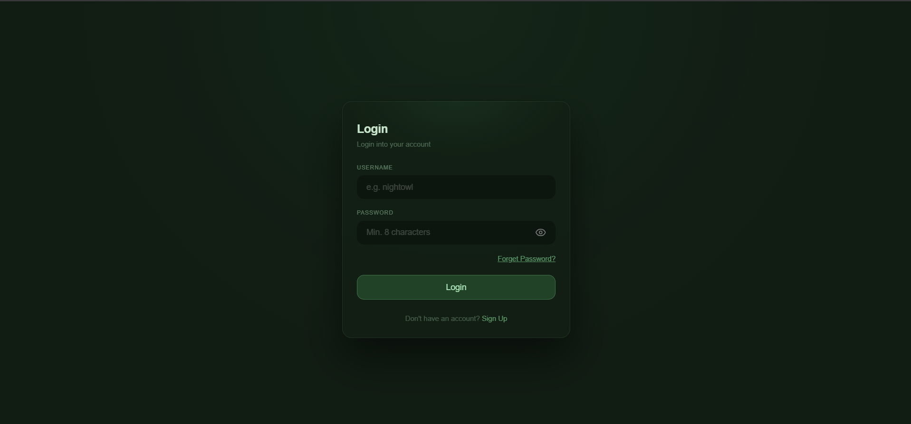
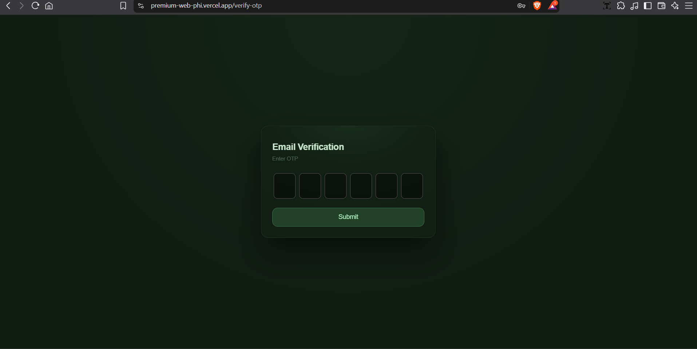
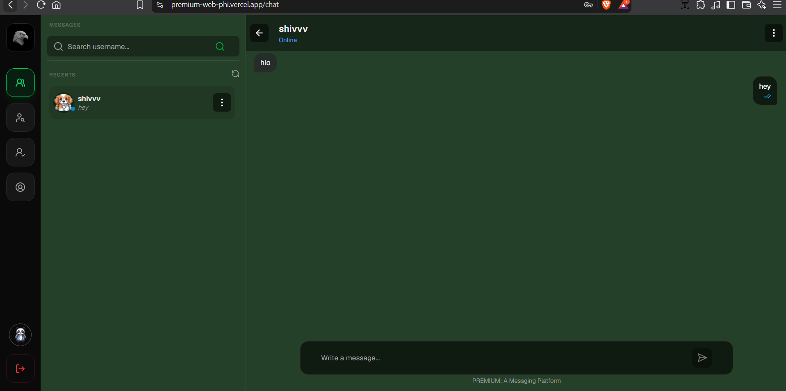

# Project Name

A real-time, web-based one-to-one chat application with email OTP verification, an invite/request system, and live message status.

!demo
https://premium-web-phi.vercel.app/

## Features

- **Secure registration with email OTP**: sign up with username, email, password and avatar; the account is created only after the OTP sent to your email is verified
- **Login / authentication**: only authenticated users can access the main chat screen
- **Invite module**: send an invite to another user to connect
- **Request module**: view the invites you have received
- **Contacts / chats list**: pick any contact from the sidebar to open the conversation
- **One-to-one real-time chat**: instant messaging over WebSockets
- **Delete messages**: remove a message you sent
- **Message status**: see the delivery status of each message right below it

## Tech Stack

**Frontend:** Next.js, React, TypeScript, TanStack Query, Zustand
**Backend:** NestJS, TypeScript, Socket.io
**Database:** MongoDB (Mongoose)
**Email Service:** Brevo (email OTP)

## User Flow

1. A new user lands on the **Login** page.
2. No account? Go to **Register** and enter username, email, password and avatar.
3. An **OTP is emailed**. Entering the correct OTP creates the account.
4. The user logs in and reaches the **main screen**:
   - **Left sidebar**: Invite module and Request module
   - **Next to the sidebar**: Contacts / Chats list
   - **Right side**: Chat screen for one-to-one messaging

## Screenshots

| Login | Register + OTP | Main Chat |
| ----- | -------------- | --------- |
|  |  |  |

## Getting Started

### Prerequisites

- Node.js (v18+)
- MongoDB (local or Atlas)
- An SMTP account for sending OTP emails

### Installation

```bash
git clone https://github.com/<your-username>/<repo-name>.git
cd <repo-name>
```

**Backend**

```bash
cd server
npm install
cp .env.example .env
npm run start:dev
```

**Frontend**

```bash
cd web
npm install
cp .env.example .env.local
npm run dev
```

The app runs on `http://localhost:3000` (frontend) and `http://localhost:3001` (backend).

### Environment Variables

**Server (`server/.env`)**

| Variable | Description |
| -------- | ----------- |
| `PORT` | Server port |
| `MONGODB_URI` | MongoDB connection string |
| `JWT_SECRET` | Secret used to sign auth tokens |
| `JWT_REFRESH_SECRET` | Secret used to get fresh refresh token |
| `JWT_EMAIL_VERIFICATION_SECRET` | Secret used to sign auth token in registering process  |
| `JWT_WS_SECRET` | Secret used to sign auth token for web socket connection  |
| `BREVO_API_KEY` | Brevo email service API key |
| `BREVO_SENDER_NAME` | Email Sender Name |
| `EMAIL_FROM` | Email used for sending mails |
| `CLIENT_URL` | Frontend URL (for CORS) |
| `NODE_ENV` | Specify current Node Environment |

**Web (`web/.env.local`)**

| Variable | Description |
| -------- | ----------- |
| `NEXT_PUBLIC_API_URL` | Backend API URL |
| `NEXT_PUBLIC_SOCKET_URL` | Socket.io server URL |

## Architecture

```
Next.js client  <--REST-->  NestJS API  <-->  MongoDB
       ^                        |
       └------ Socket.io -------┘   (real-time messages, status, delete)
```

- REST APIs handle auth, OTP verification, invites and requests.
- Socket.io handles live messaging, message status updates and message deletion.

## Folder Structure

```
.
├── web/        # Next.js frontend
├── server/     # NestJS backend
└── docs/       # Screenshots / demo
```

## Challenges & Learnings

- Keeping message status in sync between both users in real time
- Handling socket reconnection without losing messages
- Designing the OTP flow so unverified accounts never get created


## Roadmap

- [ ] Group chats
- [ ] Image / file sharing

## Contact

**Nikhil**:https://www.linkedin.com/in/nikhil-kashyap-195b1b229/ · https://github.com/nikhil-kashyap999/Premium-Web · nikhilkashyap7508@gmail.com
